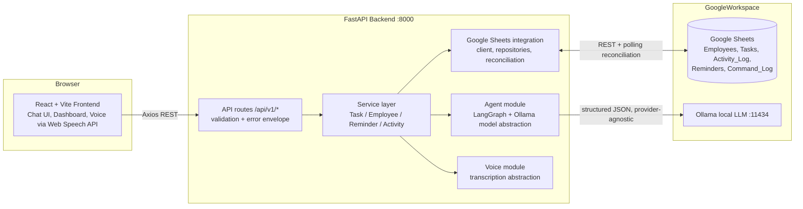

# Personal AI Project Management Agent

> An AI-powered, shared work coordinator for a small team: talk to the assistant in natural
> language (text or voice), and it manages tasks, tracks activity, and reminds people — backed by
> a simple Google Sheets data store, with the user confirming anything consequential.

**Repository status: foundation established (Milestone 0).** Application code is being implemented
per [`tasks.md`](tasks.md). This README describes the MVP as designed; features marked in
[`docs/prototype-roadmap.md`](docs/prototype-roadmap.md) that are not yet implemented are explicitly
listed under *Current limitations*.

---

## 1. What this project is

A prototype web application, built by a three-person team, where each team member interacts with an
AI assistant that acts as the team's lightweight project coordinator. The assistant interprets
free-form instructions, extracts structured actions (create/assign/complete tasks, set reminders,
log meetings), and **asks for confirmation before changing anything important**.

## 2. The problem it solves

Small teams coordinate work in chat threads and spreadsheets: tasks get lost, deadlines slip, nobody
knows what others are doing. This agent sits on top of one shared spreadsheet and turns natural
language into reliable, confirmed, logged task operations — with reminders and a dashboard.

## 3. Who will use it

An internal MVP for **a team of 3 employees** (designed to scale to ~10): each member chats with the
assistant; a lead manages assignments; everyone sees the shared dashboard.

## 4. Core MVP features

| # | Capability | Priority |
|---|-----------|----------|
| 1 | Text chat with the assistant | P0 |
| 2 | Structured task extraction from natural language | P0 |
| 3 | Confirmation before creating/modifying records | P0 |
| 4 | Google Sheets as the shared task store | P0 |
| 5 | Task listing & completion | P0 |
| 6 | Employee identification & assignment | P0 |
| 7 | Voice input (browser-based transcription) | P1 |
| 8 | Activity logging | P1 |
| 9 | Manual spreadsheet-edit detection & reconciliation | P1 |
| 10 | Basic reminders | P1 |
| 11 | Employee-wise task dashboard | P1 |
| 12 | Meeting action-item extraction (from pasted notes) | P2 |

## 5. How the application works

```text
User Input → AI Understanding → Structured Action → User Confirmation
→ Google Sheets Update → Activity Tracking → Reminder
```

1. The user types (or speaks) an instruction.
2. The LangGraph agent classifies intent and extracts a **structured action** (validated JSON).
3. The backend validates the action against application rules and schemas.
4. Consequential actions are shown to the user for **confirm/reject**.
5. Approved actions are executed by backend services that write to Google Sheets through a
   repository abstraction (the LLM never touches the spreadsheet).
6. Every change is logged in the Activity_Log; reminders are scheduled; the user gets a response.

## 6. Example user interaction

```text
User:
"Assign competitor research to me by Wednesday."

Assistant:
"I found a task:
  Competitor research
  Assigned to: You (EMP-001)
  Due date: 2026-11-11 (Wednesday)

Should I create this task?"          ← requires_confirmation: true

User:
"Yes."

Assistant:
"Task created successfully: TASK-ab12cd34."   ← executed via POST /actions/{id}/confirm
```

The assistant **never** executes important actions without confirmation. Read-only questions
("What are my pending tasks?") are answered directly without confirmation.

## 7. Architecture overview



Detailed constraints: [`docs/architecture.md`](docs/architecture.md) — agent design:
[`docs/agent-workflow.md`](docs/agent-workflow.md).

## 8. Technology stack

- **Frontend:** React + Vite + TypeScript, Tailwind CSS, Axios, React Query, Zustand
- **Backend:** Python 3.11+, FastAPI, Pydantic v2, Uvicorn
- **AI/Agent:** LangGraph, Ollama (local inference), configurable model provider
- **Integration:** Google Sheets API (service account), optional Apps Script for change detection
- **Voice:** Browser Web Speech API (MVP), pluggable transcription abstraction
- **Cost:** free/local-first. No paid APIs or cloud infrastructure as mandatory dependencies.

## 9. Repository structure

```text
logging-assistant/
├── AGENTS.md / README.md / skills.md / tasks.md / CONTRIBUTING.md
├── .env.example            ← template for all environment variables
├── .github/                ← PR/issue templates + CI workflow
├── contracts/              ← API JSON schemas (single source for field definitions)
├── docs/                   ← architecture, API contracts, data model, roadmap, ADRs
├── skills/                 ← project-specific instructions for AI coding agents
├── backend/                ← FastAPI app (Developer A)
├── agent/                  ← LangGraph orchestration (Developer A)
├── integrations/google_sheets/  ← Sheets client + repositories (Developer B)
├── voice/                  ← transcription abstraction (Developer C)
├── frontend/               ← React app (Developer C)
├── tests/                  ← unit / integration / contract tests
└── scripts/                ← dev setup helpers
```

## 10. Prerequisites

- **Python 3.11+** and **Node.js 18+** (20 recommended)
- **Ollama** — <https://ollama.com> — with at least one instruct model pulled
- A **Google account** able to create the shared spreadsheet and a service account
- Git; a GitHub account; AI coding assistant of your choice that reads `AGENTS.md`

## 11. Installation

```powershell
# Windows (PowerShell)
git clone https://github.com/AbhayShinde16325/logging-assistant.git
cd logging-assistant
.\scripts\setup_dev.ps1
```

```bash
# macOS / Linux
git clone https://github.com/AbhayShinde16325/logging-assistant.git
cd logging-assistant
bash scripts/setup_dev.sh
```

The setup scripts create the Python virtualenv and install backend + frontend dependencies.
See `docs/development-workflow.md` for the full setup on a fresh machine.

## 12. Environment variables

Copy `.env.example` → `.env` and fill in values. Key variables:

| Variable | Used by | Purpose |
|---|---|---|
| `BACKEND_PORT` | backend | FastAPI port (default 8000) |
| `VITE_API_BASE_URL` | frontend | API base URL for Axios |
| `OLLAMA_BASE_URL`, `OLLAMA_MODEL`, `MODEL_PROVIDER` | agent | Local LLM configuration |
| `GOOGLE_SHEETS_SPREADSHEET_ID`, `GOOGLE_APPLICATION_CREDENTIALS` | integration | Sheets access |
| `RECONCILIATION_POLL_SECONDS` | integration | Manual-edit polling interval |
| `API_BEARER_TOKEN` | backend | Optional shared token (MVP, local use) |

Never commit `.env` or credential files.

## 13. Run the backend

```powershell
cd backend
..\ .venv\Scripts\Activate.ps1           # once the venv exists (see scripts/)
python -m uvicorn app.main:app --host 127.0.0.1 --port 8000 --reload
```

## 14. Run the frontend

```bash
cd frontend
npm install
npm run dev      # http://localhost:5173, proxies to the backend per VITE_API_BASE_URL
```

## 15. Connect Google Sheets

1. Create a Google Sheet; copy its **spreadsheet ID** into `GOOGLE_SHEETS_SPREADSHEET_ID`.
2. In Google Cloud Console, create a **service account** with the Sheets API enabled and export a
   JSON key — store it outside the repo; set `GOOGLE_APPLICATION_CREDENTIALS` to its path.
3. Share the spreadsheet with the service-account email as **Editor**.
4. Create the five tabs (`Employees`, `Tasks`, `Activity_Log`, `Reminders`, `Command_Log`) with the
   exact headers defined in [`docs/google-sheets-schema.md`](docs/google-sheets-schema.md).

## 16. Configure Ollama

```bash
ollama pull llama3.1:8b     # or any instruct model suitable for structured JSON output
ollama serve                # default http://localhost:11434
```

Set `OLLAMA_MODEL` accordingly. The agent uses a provider abstraction — see
`skills/agent-development/SKILL.md`.

## 17. Run tests

```bash
cd backend && pytest                # unit + contract tests (mocked external services)
cd frontend && npm run test         # frontend checks
# real integration tests explicitly require credentials:
GOOGLE_SHEET_TESTS_ENABLED=1 pytest tests/integration -m integration
```

Strategy: [`docs/testing-strategy.md`](docs/testing-strategy.md).

## 18. Current limitations (the prototype is honest)

- Google Sheets is the only storage: no transactions, no history, no offline mode; eventual-consistency
  polling for manual edits (typically ≤ 60s).
- No per-user authentication — an internal shared token at most; **not production-grade security**.
- Reminders are fire-as-server-loop within the running backend process (not push notifications).
- Meeting extraction works on **pasted notes/transcripts** only; no automatic meeting joining/recording.
- Archive/audit reporting, analytics, and multi-team support are out of scope for the MVP.

## 19. Contributing

Team members and their AI agents: start with [`AGENTS.md`](AGENTS.md), then
[`CONTRIBUTING.md`](CONTRIBUTING.md) and your skill file from [`skills.md`](skills.md).
Respect the module ownership map in [`tasks.md`](tasks.md).

## 20. Roadmap

Implementation order and scope control live in [`docs/prototype-roadmap.md`](docs/prototype-roadmap.md),
with milestone-level tasks and statuses in [`tasks.md`](tasks.md). Future ideas (PostgreSQL migration,
meeting automation, analytics) are deliberately deferred until the P0 prototype works end-to-end.
