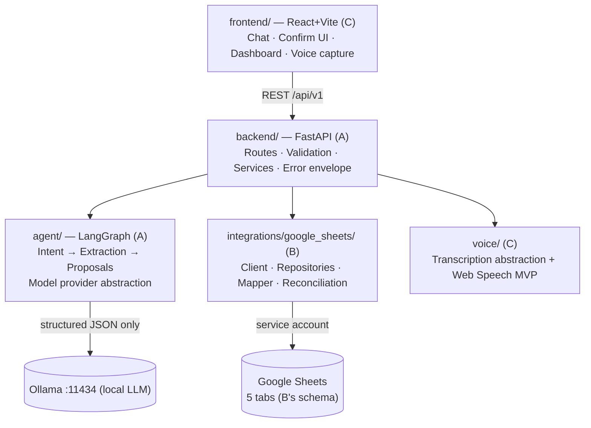
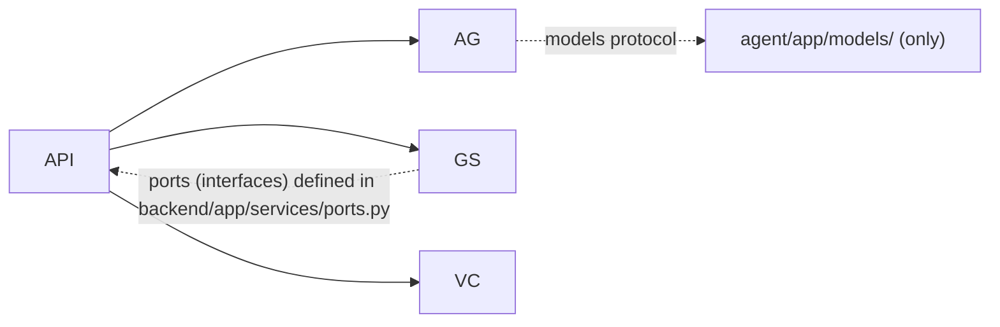

# Architecture

This document defines module boundaries, the runtime topology, and — critically for a 3-person team —
**dependency direction** so parallel work in different modules cannot conflict.

## 1. Runtime topology

Ownership is A/B/C as in `tasks.md` — one owner per layer, zero overlap.

## 2. Module boundaries

| Module | Owner | Responsibility | Boundary (this module may not) |
|---|---|---|---|
| `frontend/` | C | All UI: chat, confirm/reject, task list, dashboard, voice capture via Web Speech API. Calls **only** `backend` over HTTP. | No direct calls to Google APIs, no business rules, no credential handling |
| `backend/` | A | FastAPI app: routes, Pydantic validation, service layer, error envelope, orchestration of agent + integrations + voice. | No LLM prompts inside services; no Sheets API calls in routes |
| `agent/` | A | Pure reasoning: LangGraph state machine turning a message + context into validated `proposed_actions`. Model access only via `agent/app/models/`. | Never executes actions; never imports Sheets code; no final authority over IDs |
| `integrations/google_sheets/` | B | Repository pattern over Sheets tabs; ID generation; mapper; manual-edit reconciliation. | No API route definitions; no agent logic |
| `voice/` | C | Pluggable transcription backends + DTOs; validates audio/quality; the backend route wires it in. | No agent orchestration; transcription never feeds Sheets directly |

## 3. Dependency direction (strict)

- `backend` may import `agent`, `integrations`, `voice`, `contracts` (schema docs).
- `agent`, `integrations`, `voice` **never import `backend`**, `frontend`, or each other.
  They speak to the backend through narrow interfaces: `TaskRepository`, `EmployeeRepository`,
  `ActivityLogRepository`, `ReminderRepository`, `Transcriber` (protocol stubs shown in each module).
- The Sheets repositories implement the ports; a future DB backend would implement the same ports
  (that is the migration path — see ADR-002).

## 4. Data ownership

- Google Sheets tabs are the storage; schema authority: `docs/google-sheets-schema.md` (B).
- Entity/field definitions: `docs/data-model.md` + `contracts/*.schema.json` (A).
- The backend never re-serializes agent output straight into the repository: route (Pydantic) →
  service validation → repository mapper (B) → rows.

## 5. Cross-cutting rules

| Concern | Rule |
|---|---|
| Errors | Single envelope `{ "error": { "code", "message", "details" } }`, implemented in `backend/app/core/` and reused by every route. |
| Config | `.env` only; parsed by `backend/app/core/config.py` (Pydantic settings). Modules other than `backend` receive config as constructor parameters. |
| IDs | Generated only by repos/services with documented prefixes: `EMP-`, `TASK-`, `REM-`, `ACT-`, `LOG-`, `CONV-`. The LLM never invents them. |
| Time | ISO 8601, UTC, `YYYY-MM-DD` for dates. |
| Testing | Ports make everything mockable — unit tests use fakes; see `skills/testing-and-integration/SKILL.md`. |

## 6. Environments

| Env | Sheet | LLM | Purpose |
|---|---|---|---|
| `development` | each dev uses a **private copy** of the sheet | local Ollama | daily work |
| `test` | none — mocked repositories | mocked `ModelProvider` | pytest, CI |
| Google credentials are per-developer, never committed (`GOOGLE_APPLICATION_CREDENTIALS` path). |

## 7. Related decisions

- ADR-001 (monorepo layout), ADR-002 (Sheets as store + abstraction for migration), ADR-003
  (LangGraph orchestration) — see [`/docs/decisions`](decisions/).
